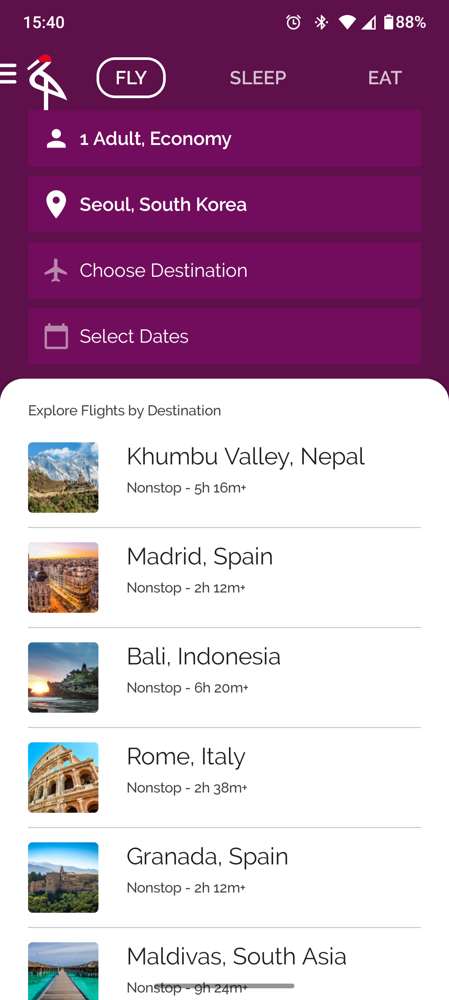
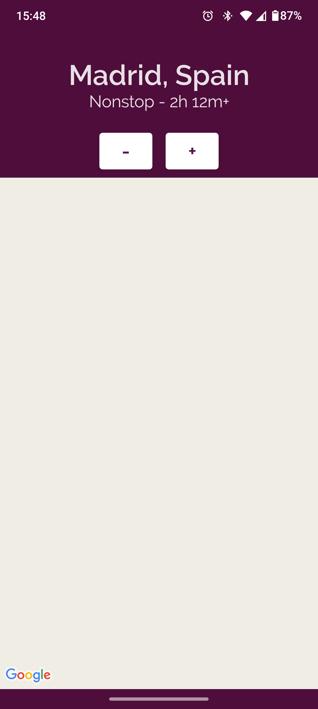
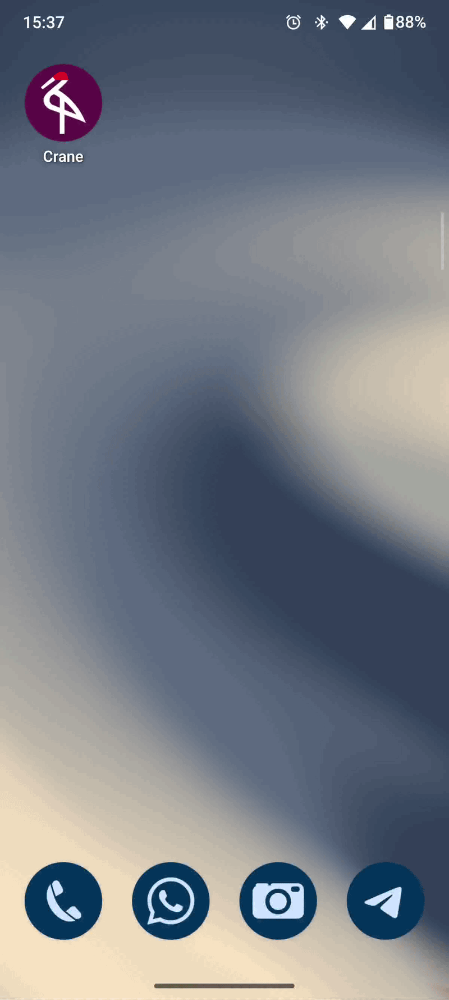

# Estado Avançado no Jetpack Compose (Crane App)

Este repositório contém a implementação prática desenvolvida durante o codelab **[Advanced State in Jetpack Compose (Estado Avançado no Jetpack Compose)](https://developer.android.com/codelabs/jetpack-compose-advanced-state-side-effects?hl=pt-br#0)**, disponibilizado pelo Google.

O objetivo deste projeto é dominar padrões avançados de gerenciamento de estado e arquitetura de UI em interfaces declarativas no Android, explorando *State Holders* personalizados, efeitos colaterais (*Side Effects*) e a execução de operações assíncronas com Coroutines e Flow.

## Tecnologias e Ferramentas Utilizadas

- **Linguagem:** Kotlin
- **UI Framework:** Jetpack Compose (Material Design)
- **Gestão de Estado Avançada:** Custom State Holders (`rememberStateHolder`), `rememberUpdatedState`, `LaunchedEffect`, `DisposableEffect`, `snapshotFlow`
- **Programação Assíncrona:** Kotlin Coroutines & `StateFlow` / `Flow`
- **Injeção de Dependência:** Hilt / Dagger
- **Carregamento de Imagens:** Coil
- **Arquitetura:** MVVM + Custom State Holders
- **IDE:** Android Studio
- **Mínimo SDK:** API level 21+

## Conceitos e Aprendizados Práticos

Durante o desenvolvimento deste codelab, os seguintes conceitos foram consolidados:

### 1. Detentores de Estado Personalizados (State Holders)
- Criação e instanciação de classes gerenciadoras de estado para encapsular a lógica complexa da UI, promovendo legibilidade, desacoplamento e facilidade de testes unitários.
- Implementação de funções `remember` personalizadas para criar e preservar os State Holders no ciclo de vida da recomposição.

### 2. Manipulação de Efeitos Colaterais (Side Effects)
- **`LaunchedEffect`:** Disparo de chamadas assíncronas atreladas à entrada de um composable na árvore de UI.
- **`rememberUpdatedState`:** Captura segura de valores ou lambdas atualizados dentro de efeitos colaterais de longa duração, evitando a reexecução desnecessária do efeito.
- **`DisposableEffect`:** Limpeza adequada de recursos e retornos de chamada quando um composable sai da tela.
- 
## Evidências do Projeto (Demonstração Prática)

### 1. Interface da Aplicação
Demonstração das abas de navegação (Voos, Hotéis, Restaurantes) e a lista de destinos.

| Tela Principal (Crane Home) | Tela de Detalhes |
| :---: | :---: |
|  |  |

### 2. Fluxo Interativo e Efeitos Colaterais (GIF)
Demonstração da animação da tela de abertura (*Splash Screen*), seleção de destinos e interações com a busca.

| Animações, Busca e Fluxo de Telas |
| :---: |
|  |

## Como Executar o Projeto

1. Clone o repositório:
   ```bash
   git clone https://github.com/leticia-farias/advanced-state-compose.git
2. Abra o projeto no Android Studio.
3. Aguarde o término da sincronização do Gradle.
4. Execute o aplicativo num emulador ou dispositivo físico (API 21+).
